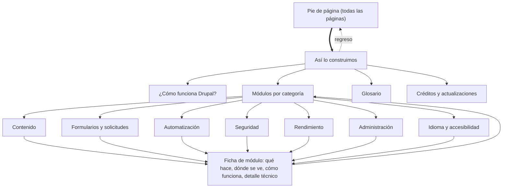

# Resident Portal for Provenza Residencial: Requirements and Navigation Chart (Proof of Concept)

**Client:** Colonos del Condominio Residencial AC
**Community:** Provenza Residencial, Av. Adolfo López Mateos Sur 5555, Tlajomulco de Zúñiga, Jalisco, C.P. 45645
**Platform:** Drupal 11
**Site language:** Latin American Spanish (es-MX). All user-facing text, menus, forms, emails and error messages are in Spanish. This document is written in English, and the real menu and page names appear in Spanish.
**Type of project:** Proof of concept (PoC), populated with sample data
**Document status:** Draft v2.0

---

## 1. Purpose and Scope

The site is the single channel through which residents interact with the company that manages Provenza Residencial. The proof of concept demonstrates that one Drupal site can replace ad hoc channels (WhatsApp groups, paper forms, phone calls to the guardhouse) with one traceable system.

| Managed area / service | What residents do on the site |
|---|---|
| Access control and private security | Pre-register visitors and providers, register vehicles, report incidents |
| Jogging areas, playground, gardens, fountains | Report damage, request maintenance, read rules and schedules |
| Fully equipped gym | Read rules and hours, report equipment issues |
| Swimming pool (*Alberca*) | Read rules and hours, report issues |
| Party ballroom (*Salón de fiestas*) | Check availability, request a reservation, read rules |
| Street lighting | Report outages with location and photo |
| Waste disposal | Read collection schedule, request special pickup, report missed pickup |
| Fees and rates | Consult the list of rates (*Cuotas y tarifas*) |

### Out of scope

- Online payments and anything that processes money
- Invoicing
- Bulk import of houses and residents (the PoC uses sample data)
- Native mobile apps
- Integration with physical access-control hardware
- Online voting in assemblies

### Sample rates shown in the PoC

The *Cuotas y tarifas* page displays the following sample values. They are randomly chosen between 200 and 500 MXN and are for demonstration only.

| Concept (*Concepto*) | Amount (MXN) |
|---|---|
| Cuota mensual de mantenimiento | $380 |
| Renta del salón de fiestas | $480 |
| Depósito en garantía del salón de fiestas | $250 |
| Pase de invitado a la alberca (por persona) | $220 |
| Tag de acceso adicional | $200 |
| Reposición de tag de acceso | $320 |
| Recolección especial de residuos | $430 |
| Uso de la alberca para evento familiar | $350 |

---

## 2. Users and Roles

| Role (Drupal role) | Description | Key permissions |
|---|---|---|
| **Visitante** (anonymous) | Anyone without a session | View public pages (home, rates, contact, privacy notice, *Así lo construimos*); start registration |
| **Residente titular** | Owner or primary account holder of a house | Everything a resident can do; manages household members |
| **Residente familiar / inquilino** | Household member or tenant linked to a house | Service requests, reservation requests, visitor pre-registration |
| **Caseta / Seguridad** | Guardhouse and patrol staff | View visitor and vehicle lists, validate QR passes, log incidents |
| **Mantenimiento** | Maintenance crew | See and update assigned service requests |
| **Administración** | Office staff | Approve registrations, manage requests, reservations, announcements, resident records, and handle all complaints, including confidential ones |
| **Mesa directiva** | Board / committee | Read-only dashboards, publish minutes |
| **Webmaster** | Technical admin | Full site configuration |

---

## 3. Functional Requirements

Priority key: **M** = Must have, **S** = Should have.

### 3.1 Accounts and access

| ID | Requirement | Priority |
|---|---|---|
| RF-01 | Residents register by submitting their house number and contact data. Administración approves or rejects each registration. | M |
| RF-02 | Each house (*domicilio*) is a record with street and house number. One or more users are linked to it, with a role of titular, familiar or inquilino. | M |
| RF-03 | Login by email and password, with password recovery. Two-factor authentication is mandatory for Administración. | M |
| RF-04 | Resident profile: name, phone, emergency contact, vehicles (plate, make, color), pets, email notification preferences. | M |
| RF-05 | Account deactivation when a house changes ownership, keeping history. | S |

### 3.2 Fees and rates (*Cuotas y tarifas*)

| ID | Requirement | Priority |
|---|---|---|
| RF-10 | A public, read-only page lists all fees and rates (see sample values in section 1). Administración edits the amounts without code. | M |
| RF-11 | Rates related to a service (ballroom, pool, tags, waste pickup) are also shown on that service's page. | S |

### 3.3 Service requests (*Solicitudes de servicio*)

| ID | Requirement | Priority |
|---|---|---|
| RF-20 | Request form with category (street lighting, gardens, fountains, jogging area, playground, gym, pool, waste, common-area repair, access tag, other), location (street or area), description and photos (up to 5). | M |
| RF-21 | Every request gets a folio and starts in status *Recibida*. Statuses: *Recibida, En revisión, Asignada, En proceso, Resuelta, Cerrada, Rechazada*. | M |
| RF-22 | Administración assigns a request to a maintenance staff member. Staff update status and add notes and evidence photos. | M |
| RF-23 | The resident sees status, history and comments, and receives an email on each status change. | M |
| RF-24 | The resident rates the service once the request is resolved (1 to 5 stars and a comment). | S |
| RF-25 | Special waste pickup request with date selection. | S |

### 3.4 Complaints and suggestions (*Quejas y sugerencias*)

| ID | Requirement | Priority |
|---|---|---|
| RF-30 | Form for complaints, suggestions and compliments, with types: noise, neighbor conflict, pets, parking, security staff conduct, service quality, rule violation, other. | M |
| RF-31 | Option to file confidentially (the reporter is visible only to Administración). | M |
| RF-32 | Complaint workflow handled by Administración: *Recibida, En investigación, Acción tomada, Cerrada*, with private internal notes and a public resolution message. | M |

### 3.5 Facilities and reservations (*Instalaciones y reservaciones*)

| ID | Requirement | Priority |
|---|---|---|
| RF-40 | Facility catalog: party ballroom, gym, swimming pool, jogging areas, playground, gardens, fountains. Each has description, photos, rules, hours and capacity. | M |
| RF-41 | Party ballroom availability calendar showing booked, blocked and free dates. | M |
| RF-42 | Reservation request by a resident, with guest count, event type and rules acceptance. | M |
| RF-43 | Reservation approval workflow handled by Administración: *Solicitada, Aprobada, Realizada, Rechazada, Cancelada*, with an email at each change. | M |
| RF-44 | Pool page with rules, opening hours, guest policy and maintenance closures. | M |

### 3.6 Security and access (*Seguridad y acceso*)

| ID | Requirement | Priority |
|---|---|---|
| RF-50 | Visitor pre-registration: name, date and time window, vehicle plate, number of people. The system generates a QR pass the resident can share. | M |
| RF-51 | Recurring authorizations for domestic staff, caregivers and regular providers, with expiry dates. | M |
| RF-52 | Guardhouse view (*Vista de caseta*): today's expected visitors and providers, searchable by house or plate, optimized for tablets, with check-in and check-out marking. | M |
| RF-53 | Vehicle and access-tag register per house, with request for new or replacement tags. | S |
| RF-54 | Incident report form with date, place, description and photos. Security staff can also log incidents. | M |
| RF-55 | Emergency contacts page (guardhouse, administration, civil protection), with click-to-call on mobile. | M |
| RF-56 | Access rules page (visitors, providers, move-ins and move-outs, construction works). | M |

### 3.7 Community information (*Comunidad*)

| ID | Requirement | Priority |
|---|---|---|
| RF-60 | Announcements (*Avisos*) with categories (general, security, maintenance, events), publish scheduling, and optional email to residents. | M |
| RF-61 | Calendar of events and scheduled works (assemblies, water or power outages, gardening days, fumigation, waste collection). | M |
| RF-62 | Document library with access by role: community rules (*Reglamento*), assembly minutes (*actas*), forms. | M |
| RF-63 | Frequently asked questions, searchable. | M |
| RF-64 | Directory of services and contacts. | S |

### 3.8 Contact and general site

| ID | Requirement | Priority |
|---|---|---|
| RF-70 | General contact form routed by email to Administración, with spam protection. | M |
| RF-71 | Home page with login, urgent notices, quick actions (request, reserve, register visitor, report incident, view rates) and next events. | M |
| RF-72 | Site search over public and role-permitted content. | M |
| RF-73 | Privacy notice (*Aviso de privacidad*) and terms of use pages. | M |
| RF-74 | Footer-only tutorial area **Así lo construimos** (see section 6). | M |

### 3.9 Back office (*Administración*)

| ID | Requirement | Priority |
|---|---|---|
| RF-80 | Resident and house management: approve registrations, edit, deactivate. | M |
| RF-81 | Unified queue for requests, complaints, reservations and incidents, with filters, assignment, bulk actions and exports. | M |
| RF-82 | Audit trail of who changed what (statuses, permissions). | M |
| RF-83 | Management dashboard: open items by age, resolution times, satisfaction, incidents by month. | S |
| RF-84 | Notification email templates editable in Spanish by Administración without code. | S |

---

## 4. Non-Functional Requirements

| ID | Area | Requirement |
|---|---|---|
| RNF-01 | Language | The whole interface is Latin American Spanish (es-MX): dates (dd/mm/aaaa), currency (MXN, `$1,234`), Mexican vocabulary (*colonos, caseta, cuota*). Time zone: America/Mexico_City. |
| RNF-02 | Responsive design | Mobile-first. Key flows (request, reserve, pre-register visitor) work on a 360 px wide screen. |
| RNF-03 | Accessibility | WCAG 2.2 level AA basics: contrast, keyboard navigation, alt text, form labels and error messages. |
| RNF-04 | Performance | Page and block caching enabled. Images are responsive and compressed. |
| RNF-05 | Security | HTTPS, role-based access, private file storage for documents and uploads, brute-force protection. |
| RNF-06 | Notifications | Email only, sent from an authenticated domain. |
| RNF-07 | Design | Neutral, clean theme without custom branding. |
| RNF-08 | Maintainability | Configuration in code (Drupal configuration management) and Composer-based dependencies. |
| RNF-09 | Browser support | Last two major versions of Chrome, Safari, Firefox and Edge, on Android and iOS. |

---

## 5. Drupal Architecture: Modules

The brief requires at least 17 different modules. The tables list **46 entries**: 22 core entries (some group closely related modules) and 24 contributed modules. Every module installed in the PoC is documented in the tutorial *Así lo construimos*.

### 5.1 Core modules

| # | Module | What it does | Where it is used on this site |
|---|---|---|---|
| 1 | **Node** | Content items and content types | Announcements, facilities, FAQs, documents, tutorial entries |
| 2 | **User** | Accounts, roles, permissions | The eight roles in section 2 |
| 3 | **Field / Field UI** | Adds custom fields to content | Vehicle plate, house number, request category, photos |
| 4 | **Views** | Lists, tables and dashboards with filters | "Mis solicitudes", guardhouse view, admin queues |
| 5 | **Taxonomy** | Categories and tags | Request categories, announcement types, complaint types |
| 6 | **Menu UI** | Editable menus | Main menu, footer menu, user menu |
| 7 | **Media / Media Library** | Reusable images and files | Facility photos, documents |
| 8 | **File / Image / Responsive Image** | Uploads and responsive image sizes | Evidence photos, mobile-friendly images |
| 9 | **Path** | Friendly URLs and aliases | `/instalaciones/alberca` |
| 10 | **Language / Locale / Content Translation / Config Translation** | Interface and configuration in Spanish | Entire site in es-MX |
| 11 | **Workflows + Content Moderation** | Statuses and transition rules | Request, complaint and reservation lifecycles; editorial review |
| 12 | **Contact** | Basic contact forms | General contact |
| 13 | **Block / Block Content** | Placing content in regions | Quick-action tiles on home, urgent notice banner |
| 14 | **Layout Builder** | Visual page layout | Home page and facility pages |
| 15 | **Datetime / Datetime Range** | Date fields | Events, reservations, visitor windows |
| 16 | **Search** | Basic search | Fallback while Search API is configured |
| 17 | **Database Logging** | Event logging | Technical error and audit logs |
| 18 | **Automated Cron** | Scheduled tasks | Scheduled announcements, reminders |
| 19 | **Update Manager** | Alerts on available updates | Keeping security patches current |
| 20 | **Page Cache / Dynamic Page Cache / BigPipe** | Performance caching | Fast pages for anonymous and logged-in users |
| 21 | **Options / Text / Link / Telephone / Email** | Field types | Click-to-call numbers, email fields, links |
| 22 | **Config** | Configuration management | Moving the site setup between environments |

### 5.2 Contributed modules

| # | Module | What it does | Where it is used on this site |
|---|---|---|---|
| 23 | **Webform** | Advanced form builder with handlers and submissions | Service requests, complaints, incident reports, visitor pre-registration, reservation requests |
| 24 | **ECA (Events, Conditions, Actions)** | No-code automation of workflows | Status-change emails, assignment notices |
| 25 | **Smart Date** | Better date and recurrence handling | Ballroom calendar, recurring authorizations, events |
| 26 | **Paragraphs** | Flexible content blocks | Facility pages, FAQs, tutorial module pages |
| 27 | **Pathauto** | Automatic URL aliases | Consistent Spanish URLs |
| 28 | **Token** | Placeholders in text and emails | "Hola [user:name], tu folio es [node:folio]" |
| 29 | **Metatag** | Page titles and social previews | Public pages |
| 30 | **Redirect** | Automatic redirects | Keeps old links working |
| 31 | **Simple XML Sitemap** | Sitemap for search engines | Public pages only (excludes *Así lo construimos*) |
| 32 | **Admin Toolbar** | Faster admin navigation | Staff back office |
| 33 | **Gin** (admin theme) | Modern, accessible admin interface | Staff back office |
| 34 | **Field Group** | Groups fields into tabs and sections | Long forms and admin screens |
| 35 | **Views Bulk Operations** | Apply actions to many items at once | Assign several requests at once |
| 36 | **Better Exposed Filters** | Friendlier filter widgets | Filters in queues and lists |
| 37 | **Views Data Export** | Export view results to CSV/XLSX | Management reports |
| 38 | **Charts** | Charts from Views data | Request volume, incidents by month |
| 39 | **Entity Print** | Generate PDFs | Assembly minutes, reservation confirmations |
| 40 | **Search API + Search API Database** | Advanced search with facets | FAQs, documents, announcements |
| 41 | **Drupal Symfony Mailer** | Reliable, templated email | Transactional emails |
| 42 | **Honeypot** and **reCAPTCHA v3** | Spam prevention | Registration, contact, complaint forms |
| 43 | **TFA (Two-factor Authentication)** | Second login factor | Administración accounts |
| 44 | **Password Policy** | Enforces strong passwords | All accounts |
| 45 | **Scheduler** | Publish and unpublish at set times | Announcements and notices |
| 46 | **Flag** | Lets users mark content | Residents bookmark documents and FAQs; staff flag priority items |

### 5.3 Key content types and entities

| Entity | Type | Main fields |
|---|---|---|
| `Domicilio` (House) | Content type | Street, house number, titular, status |
| `Solicitud de servicio` | Webform submission + node | Folio, category, location, photos, status, assignee, rating |
| `Queja o sugerencia` | Webform submission + node | Folio, type, confidential flag, status, internal notes |
| `Reservación` | Node | Facility, date range, guests, status |
| `Visita / Autorización` | Webform submission + node | Visitor, window, plate, QR code, status |
| `Incidente` | Node | Date, location, description, photos, reporter |
| `Aviso` | Node | Title, body, category, publish date |
| `Documento` | Media + node | File, type, audience roles, date |
| `Instalación` | Node | Description, rules, hours, capacity, photos, related rate |
| `Tarifa` | Node | Concept, amount (MXN) |
| `Módulo documentado` | Node (for the tutorial) | Name, category, function, where used, screenshot, steps |

---

## 6. "Así lo construimos" (Footer-Only Tutorial Area)

### 6.1 Purpose

A public tutorial that explains how the site was built: which Drupal modules are used and what each one does, in plain Spanish for a non-technical audience, with optional technical detail.

### 6.2 Access rules

| ID | Rule |
|---|---|
| AC-01 | The **only** link to this area is in the **site footer**, with the text *Así lo construimos*. |
| AC-02 | It does **not** appear in the main menu, user menu, home page tiles, search results, in-site search index, or the visible sitemap page. |
| AC-03 | It is excluded from the XML sitemap and marked `noindex`. |
| AC-04 | The tutorial's internal pages link to each other and back to the footer. |
| AC-05 | The footer link is visible on every page, for logged-in and anonymous users. |
| AC-06 | The area is public: no login is required. |

### 6.3 Content structure

| Page | Content |
|---|---|
| **Así lo construimos** (landing) | What Drupal is, a simple diagram of how the site's pieces fit, and how to read the tutorial |
| **¿Cómo funciona Drupal?** | Core vs. contributed modules, content types, roles, views, blocks, in everyday language |
| **Módulos por categoría** | Cards grouped as: Contenido, Formularios y solicitudes, Automatización, Seguridad, Rendimiento, Administración, Idioma y accesibilidad |
| **Ficha de cada módulo** | One page per module with the sections below |
| **Glosario** | Short definitions (módulo, nodo, vista, rol, flujo de trabajo, etc.) |
| **Créditos y actualizaciones** | Drupal community acknowledgment, last update date, versions |

**Each module page contains:**
1. Module name and category.
2. What it does, in one sentence.
3. Where you can see it on this site, with a screenshot.
4. How it works, in 3 to 5 steps.
5. Optional "Detalle técnico" collapsible block.
6. Module version and a link to its project page on drupal.org.

### 6.4 Build approach

- Use the `Módulo documentado` content type so editors can update the list without a developer.
- The category cards and module list pages are Views built from that content type.

---

## 7. Navigation Chart

### 7.1 Site map (public and resident areas)

```mermaid
flowchart TD
    HOME["Inicio"]

    HOME --> SOL["Solicitudes de servicio"]
    HOME --> QUEJAS["Quejas y sugerencias"]
    HOME --> INST["Instalaciones y reservaciones"]
    HOME --> SEG["Seguridad y acceso"]
    HOME --> COM["Comunidad"]
    HOME --> CONT["Contacto"]
    HOME --> CUENTA["Mi cuenta"]

    SOL --> S1["Nueva solicitud"]
    SOL --> S2["Mis solicitudes y seguimiento"]
    SOL --> S3["Recolección especial de residuos"]
    SOL --> S4["Calificar servicio"]

    QUEJAS --> Q1["Nueva queja o sugerencia"]
    QUEJAS --> Q2["Mis quejas y seguimiento"]
    QUEJAS --> Q3["Reporte confidencial"]

    INST --> I1["Salón de fiestas"]
    INST --> I2["Gimnasio"]
    INST --> I3["Alberca"]
    INST --> I4["Trotapista y áreas verdes"]
    INST --> I5["Juegos infantiles"]
    INST --> I6["Fuentes y jardines"]
    I1 --> I1a["Calendario de disponibilidad"]
    I1 --> I1b["Solicitar reservación"]
    I1 --> I1c["Mis reservaciones"]
    I1 --> I1d["Reglas y tarifas"]
    I3 --> I3a["Reglas y horarios"]
    I3 --> I3b["Pases de invitado"]
    I3 --> I3c["Reportar un problema"]

    SEG --> SG1["Registrar visita o proveedor"]
    SEG --> SG2["Mis autorizaciones y pases QR"]
    SEG --> SG3["Mis vehículos y tags"]
    SEG --> SG4["Reportar incidente"]
    SEG --> SG5["Reglamento de acceso"]
    SEG --> SG6["Teléfonos de emergencia"]

    COM --> C1["Avisos"]
    COM --> C2["Calendario de eventos"]
    COM --> C3["Cuotas y tarifas"]
    COM --> C4["Documentos y reglamento"]
    COM --> C5["Actas de asamblea"]
    COM --> C6["Preguntas frecuentes"]
    COM --> C7["Directorio"]

    CUENTA --> U1["Iniciar sesión / Registrarme"]
    CUENTA --> U2["Mi perfil"]
    CUENTA --> U3["Mi domicilio y familiares"]
    CUENTA --> U4["Notificaciones por correo"]
    CUENTA --> U5["Seguridad de la cuenta"]

    HOME -.->|"solo desde el pie de página"| FOOT["Pie de página"]
    FOOT --> F1["Aviso de privacidad"]
    FOOT --> F2["Términos de uso"]
    FOOT --> F3["Accesibilidad"]
    FOOT --> F4["Mapa del sitio"]
    FOOT --> F5["Contacto"]
    FOOT ==> F6["Así lo construimos"]
```

### 7.2 Footer-only tutorial path

### 7.3 Back office (staff only, not linked from public navigation)

```mermaid
flowchart TD
    ADM["Panel de administración"] --> A1["Bandeja unificada: solicitudes, quejas, reservaciones, incidentes"]
    ADM --> A2["Residentes y domicilios"]
    ADM --> A3["Comunicación"]
    ADM --> A4["Contenido del sitio"]
    ADM --> A5["Reportes y tableros"]
    ADM --> A6["Configuración"]

    A2 --> A2a["Aprobar, editar y desactivar cuentas"]
    A3 --> A3a["Avisos"]
    A3 --> A3b["Plantillas de correo"]
    A4 --> A4a["Instalaciones, FAQs, documentos"]
    A4 --> A4b["Tarifas"]
    A4 --> A4c["Módulos documentados (Así lo construimos)"]
    A5 --> A5a["Tiempos de atención"]
    A5 --> A5b["Incidentes"]
    A5 --> A5c["Satisfacción"]
    A6 --> A6a["Roles y permisos"]
    A6 --> A6b["Categorías"]
    A6 --> A6c["Auditoría"]

    GUARD["Vista de caseta (tableta)"] --> G1["Visitas esperadas hoy"]
    GUARD --> G2["Buscar por casa o placa"]
    GUARD --> G3["Registrar entrada y salida"]
    GUARD --> G4["Registrar incidente"]
```

### 7.4 Menu definitions

| Menu | Items (Spanish labels) | Visible to |
|---|---|---|
| **Main menu** | Inicio · Solicitudes · Quejas y sugerencias · Instalaciones · Seguridad y acceso · Comunidad · Contacto | Everyone (restricted pages request login) |
| **User menu** | Iniciar sesión / Registrarme (anonymous) · Mi perfil · Mi domicilio · Notificaciones · Cerrar sesión | Everyone / logged-in |
| **Quick actions** (home tiles) | Nueva solicitud · Reservar salón · Registrar visita · Reportar incidente · Ver tarifas | Logged-in residents |
| **Footer menu** | Aviso de privacidad · Términos de uso · Accesibilidad · Mapa del sitio · Contacto · **Así lo construimos** | Everyone |
| **Staff menu** | Panel de administración · Bandeja unificada · Reportes | Staff roles only |
| **Guardhouse menu** | Vista de caseta | Caseta / Seguridad only |

### 7.5 Page access matrix

| Area | Visitante | Residente | Caseta | Mantenimiento | Administración | Mesa directiva |
|---|:-:|:-:|:-:|:-:|:-:|:-:|
| Inicio, Contacto, Avisos generales | ✔ | ✔ | ✔ | ✔ | ✔ | ✔ |
| Cuotas y tarifas | ✔ | ✔ | ✔ | ✔ | ✔ | ✔ |
| Solicitudes de servicio | | ✔ | | Assigned | ✔ | Read |
| Quejas y sugerencias | | ✔ | | | ✔ | |
| Instalaciones (información) | ✔ | ✔ | ✔ | ✔ | ✔ | ✔ |
| Reservaciones | | ✔ | | | ✔ | Read |
| Registro de visitas | | ✔ | ✔ | | ✔ | Read |
| Vista de caseta | | | ✔ | | ✔ | |
| Documentos y actas | Public only | ✔ | | | ✔ | ✔ |
| Panel de administración | | | | | ✔ | |
| Así lo construimos | ✔ (via footer) | ✔ (via footer) | ✔ | ✔ | ✔ | ✔ |

---

## 8. Key User Flows

1. **Report a street light outage:** *Solicitudes* → *Nueva solicitud* → category *Alumbrado* → location and photo → folio → email updates until *Resuelta* → rating.
2. **Reserve the ballroom:** *Instalaciones* → *Salón de fiestas* → calendar → request → Administración approves → email confirmation → event → *Realizada*.
3. **Check pool rules and rates:** *Instalaciones* → *Alberca* → rules, hours and guest pass rate.
4. **Pre-register a visitor:** *Seguridad y acceso* → *Registrar visita* → QR pass → guard validates in *Vista de caseta*.
5. **File a confidential complaint:** *Quejas* → *Nueva queja* → mark confidential → Administración handles it → follow-up through *Mis quejas*.
6. **View rates:** *Comunidad* → *Cuotas y tarifas*.
7. **Learn how the site was built:** any page → footer → *Así lo construimos* → *Módulos por categoría* → module page.

---

## 9. Delivery Phases

| Phase | Scope | Outcome |
|---|---|---|
| **1. Foundation** | Drupal install, Spanish localization, roles, houses and accounts, neutral theme, content types, home, menus, footer, sample data | Residents can log in and read information |
| **2. Core services** | Service requests, complaints, reservations, visitor pre-registration, guardhouse view, incidents, announcements, documents, rates, contact | Main resident interactions work end to end |
| **3. Tutorial and demo** | *Así lo construimos*, back office dashboards, basic accessibility and security review, demo walkthrough | PoC ready to present |

---

## 10. Acceptance Criteria

- The site is entirely in Latin American Spanish, with no English strings visible to residents.
- At least 17 distinct Drupal modules are in use (target: all 46 listed), and every installed module is documented in *Así lo construimos*.
- *Así lo construimos* is public and reachable by clicking the footer link on any page, and by no other navigation element, sitemap or search.
- The *Cuotas y tarifas* page shows sample rates between 200 and 500 MXN.
- A resident can complete each flow in section 8 on a phone without help.
- The pool appears in the facility catalog, the navigation and the service request categories.
- Administración can approve registrations, handle complaints (including confidential ones) and update content, rates and tutorial entries without a developer.
- All notifications are sent by email only.
